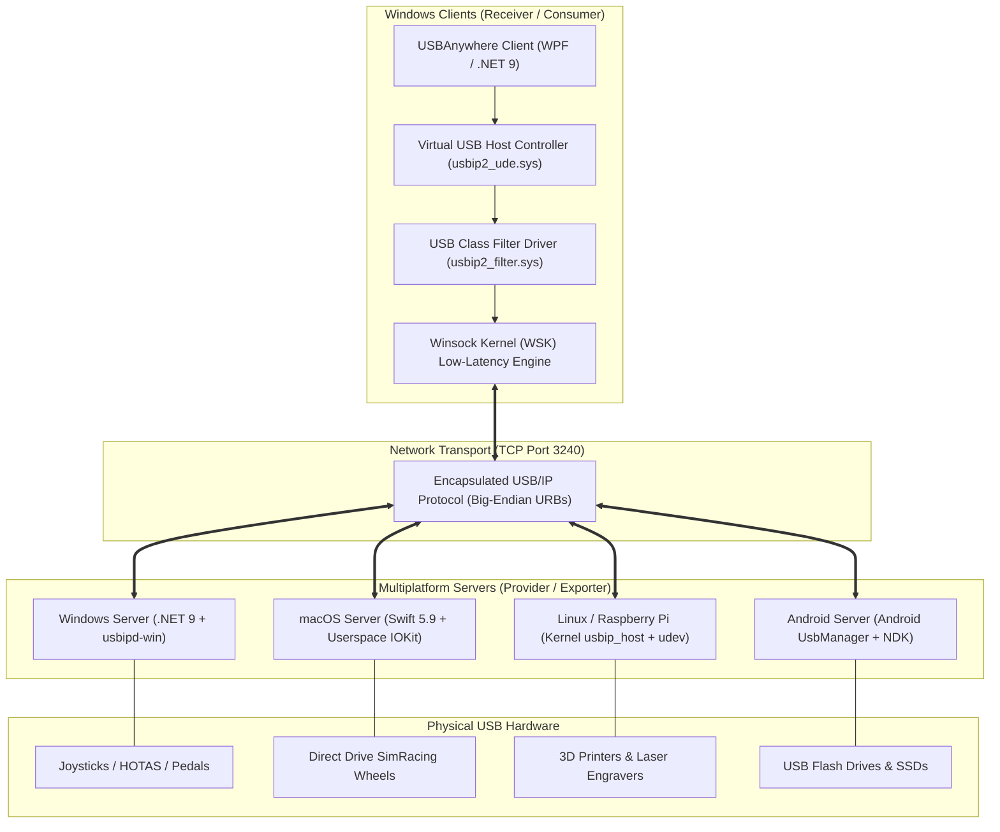

# 🏛️ USBAnywhere System Architecture

🌐 **Language / Idioma:** **English** | [Español](ARCHITECTURE_ES.md)

This document provides a comprehensive technical breakdown of the **USBAnywhere** multiplatform ecosystem, network wire protocol, driver subsystems, and security boundaries.

---

## 🗺️ 1. High-Level Ecosystem Architecture

---

## 🌐 2. USB/IP Wire Protocol Specification

USBAnywhere communicates strictly using the standard **USB/IP** binary wire protocol over TCP port `3240`. All protocol fields are serialized in **network byte order (Big-Endian)**.

### A. Management Phase (Handshake)
Before any data transfers occur, client and server negotiate devices:

1. **`OP_REQ_DEVLIST` (`0x8005`)**: Client queries the server for exported devices.
   - Request: `version (uint16 = 0x0111)`, `command (uint16 = 0x8005)`, `status (uint32 = 0x0000)`.
   - Reply (`OP_REP_DEVLIST` `0x0005`): `version`, `command`, `status`, `ndev (uint32)`, followed by `ndev` device descriptor structures (busid, vendorId, productId, speed, class, interfaces).
2. **`OP_REQ_IMPORT` (`0x8003`)**: Client requests exclusive attachment to a specific USB bus ID.
   - Request: `version`, `command`, `status`, `busid (char[32])`.
   - Reply (`OP_REP_IMPORT` `0x0003`): `version`, `command`, `status (0 = OK)`, full device descriptor. Once imported, the TCP socket transitions permanently to the **URB Phase**.

### B. URB Phase (Data Streaming)
All transfers between virtual host and device are encapsulated into USB Request Blocks (URBs):

- **`USBIP_CMD_SUBMIT` (`0x00000001`)**: Virtual host submits an I/O transfer (Control, Bulk, Interrupt, Isochronous) to the physical peripheral.
- **`USBIP_RET_SUBMIT` (`0x00000003`)**: Host server returns the completed transfer status and payload data.
- **`USBIP_CMD_UNLINK` (`0x00000002`)**: Cancels a pending transfer request.
- **`USBIP_RET_UNLINK` (`0x00000004`)**: Confirms transfer cancellation.

---

## 🖥️ 3. Windows Client Internals (`client/`)

The Windows client is constructed in modern C# (.NET 9.0) using the MVVM pattern with clean service abstraction:

1. **`DriverService`**:
   - Manages installation, verification, and teardown of the virtual USB host controller node (`ROOT\USBIP_WIN2\UDE`).
   - Uses `pnputil.exe` to inspect device node status and cleans up duplicate nodes before allocating virtual ports.
2. **`UsbIpService`**:
   - Wraps `usbipw.exe` CLI invocations with strict argument whitelisting (`InputValidator`).
   - Parses stdout regex streams for device listings, port statuses, and connection errors.
   - Dynamically selects between `--receive-mode zero-copy` (bulk throughput) and `--receive-mode low-latency` (WSK kernel callbacks).
3. **`DeviceMonitorService`**:
   - Asynchronous background polling loop monitoring TCP ping latency and port states.
4. **`UpdateService`**:
   - Downloads GitHub release manifests, enforces HTTPS whitelisting (`github.com`), and validates the package SHA-256 against `SHA256SUMS.txt` before execution.
5. **`SignatureVerifier`**:
   - Validates Microsoft Authenticode digital certificates on all bundled native helper tools.

---

## 🍎 4. macOS Server Internals (`USBAnywhere.Server.Mac`)

Built natively in Swift 5.9+ without third-party frameworks:

- **Userspace IOKit**:
  Directly uses Apple's `IOKit.framework` and `IOUSBHostInterface`. Avoids deprecated Kernel Extensions (`.kext`) and retains complete compatibility with Apple Silicon System Integrity Protection (SIP).
- **Interface Seizure**:
  Calls `USBDeviceOpenSeize` or `USBInterfaceOpenSeize` on target USB services to release control from macOS default class drivers (e.g. system HID) and grant exclusive pipe transfer privileges to the USB/IP daemon.
- **Async Event Loop**:
  Manages non-blocking client connections using standard BSD POSIX sockets wrapped in Grand Central Dispatch (`DispatchQueue`).
- **`launchd` Service**:
  Configured as a system LaunchDaemon (`/Library/LaunchDaemons/com.usbanywhere.server.plist`) granting root-level device ownership while running automatically at system boot.

---

## 🐧 5. Linux / Raspberry Pi Server (`scripts/install-server.sh`)

Leverages the Linux kernel's built-in USB/IP subsystem:
- Kernel modules: `usbip_core.ko`, `usbip_host.ko`.
- Systemd daemon: Manages background execution of `usbipd`.
- Udev Hotplug Rule (`99-usbip-autobind.rules`): Listens for `KERNEL=="*-*", SUBSYSTEM=="usb"` events and automatically invokes `usbip bind -b <busid>` whenever a new peripheral is attached.

---

## 🛡️ 6. Security & Privilege Separation

| Layer | Privilege Level | Mitigations |
|---|---|---|
| **Windows Client UI** | Standard User / UAC Prompt on Driver Install | Input sanitization, SHA-256 update verification, no shell injection. |
| **Windows UDE Driver** | Kernel Mode (Ring 0) | Microsoft WHQL digital signature, HVCI / Core Isolation compliance. |
| **Windows Server** | Administrator (Elevated) | Scoped Windows Firewall rule to Private & Domain profiles only. |
| **macOS Server** | Root (`launchd` daemon) | Userspace IOKit only; no SIP bypass, memory safety via Swift. |
| **Linux Server** | System Service (`usbipd`) | Sandboxed systemd unit, udev restriction to physical USB buses. |

---

## 📄 License

GPL-3.0 License. Developed by [oscarlosu-lab](https://github.com/oscarlosu-lab).
