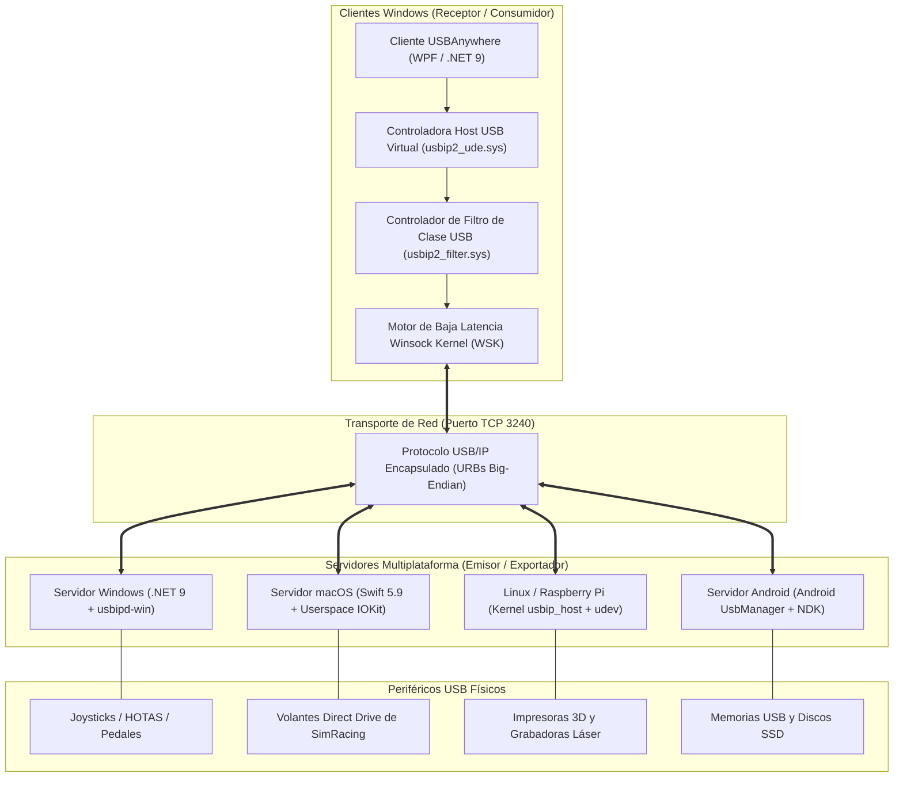

# 🏛️ Arquitectura del Sistema USBAnywhere

🌐 **Idioma / Language:** [English](ARCHITECTURE_EN.md) | **Español**

Este documento detalla la arquitectura técnica global del ecosistema multiplataforma **USBAnywhere**, el protocolo de red binario, los subsistemas de controladores y los límites de seguridad.

---

## 🗺️ 1. Arquitectura de Alto Nivel del Ecosistema

---

## 🌐 2. Especificación del Protocolo USB/IP

USBAnywhere se comunica estrictamente mediante el protocolo binario estándar **USB/IP** sobre el puerto TCP `3240`. Todos los campos numéricos se transmiten en **orden de bytes de red (Big-Endian)**.

### A. Fase de Negociación y Gestión
Antes de transmitir datos, cliente y servidor negocian los dispositivos:

1. **`OP_REQ_DEVLIST` (`0x8005`)**: El cliente solicita la lista de periféricos exportados.
   - Petición: `version (uint16 = 0x0111)`, `command (uint16 = 0x8005)`, `status (uint32 = 0x0000)`.
   - Respuesta (`OP_REP_DEVLIST` `0x0005`): `version`, `command`, `status`, `ndev (uint32)`, seguido de `ndev` descriptores de dispositivo (bus ID, Vendor ID, Product ID, velocidad, clase e interfaces).
2. **`OP_REQ_IMPORT` (`0x8003`)**: El cliente solicita la conexión exclusiva a un bus ID determinado.
   - Petición: `version`, `command`, `status`, `busid (char[32])`.
   - Respuesta (`OP_REP_IMPORT` `0x0003`): `version`, `command`, `status (0 = OK)` y descriptor completo del dispositivo. Tras esta respuesta, el socket TCP pasa permanentemente a la **Fase URB**.

### B. Fase URB (Transmisión de Datos en Tiempo Real)
Todas las operaciones I/O entre el host virtual y el periférico se encapsulan en Bloques de Petición USB (URBs):

- **`USBIP_CMD_SUBMIT` (`0x00000001`)**: El host virtual envía una transferencia de datos (Control, Bulk, Interrupt, Isochronous) hacia el periférico físico.
- **`USBIP_RET_SUBMIT` (`0x00000003`)**: El servidor devuelve el estado completado de la transferencia y los datos recibidos del dispositivo.
- **`USBIP_CMD_UNLINK` (`0x00000002`)**: Cancela una petición de transferencia pendiente.
- **`USBIP_RET_UNLINK` (`0x00000004`)**: Confirma la cancelación de la transferencia.

---

## 🖥️ 3. Arquitectura del Cliente Windows (`client/`)

El cliente está desarrollado en C# moderno (.NET 9.0) con patrón MVVM y desacoplamiento de servicios:

1. **`DriverService`**:
   - Administra la instalación, validación y desinstalación del nodo host USB virtual (`ROOT\USBIP_WIN2\UDE`).
   - Emplea `pnputil.exe` para supervisar el estado PnP y previene nodos duplicados antes de conectar puertos virtuales.
2. **`UsbIpService`**:
   - Invoca el CLI `usbipw.exe` bajo validación de parámetros estricta por lista blanca (`InputValidator`).
   - Procesa salidas regex para listar dispositivos, verificar puertos y capturar errores de conexión.
   - Alterna dinámicamente entre `--receive-mode zero-copy` (máximo rendimiento) y `--receive-mode low-latency` (callbacks WSK en kernel).
3. **`DeviceMonitorService`**:
   - Bucle de sondeo asíncrono en segundo plano que mide la latencia de ping TCP en tiempo real y detecta cambios de estado.
4. **`UpdateService`**:
   - Descarga manifiestos oficiales de GitHub, restringe peticiones a hosts HTTPS autorizados (`github.com`) y valida el hash criptográfico SHA-256 contra `SHA256SUMS.txt` antes de ejecutar cualquier instalador.
5. **`SignatureVerifier`**:
   - Valida firmas digitales Microsoft Authenticode en todos los ejecutables y librerías distribuidas.

---

## 🍎 4. Arquitectura del Servidor macOS (`USBAnywhere.Server.Mac`)

Desarrollado de forma nativa en Swift 5.9+ sin dependencias externas:

- **Userspace IOKit**:
  Interactúa directamente con `IOKit.framework` y `IOUSBHostInterface`. No utiliza extensiones de kernel (`.kext`) y mantiene compatibilidad total con el aislamiento SIP (*System Integrity Protection*) de Apple Silicon.
- **Captura Exclusiva de Interfaces (Seize)**:
  Ejecuta `USBDeviceOpenSeize` o `USBInterfaceOpenSeize` sobre los servicios USB de macOS para liberar el dispositivo de los drivers por defecto del sistema (ej. driver HID) y ceder el control exclusivo de los pipes al daemon USB/IP.
- **Bucle de Eventos Asíncrono**:
  Gestión de conexiones concurrentes mediante sockets BSD POSIX integrados en Grand Central Dispatch (`DispatchQueue`).
- **Servicio `launchd`**:
  Registrado como demonio del sistema (`/Library/LaunchDaemons/com.usbanywhere.server.plist`) para ejecutarse con privilegios de root automáticamente en el arranque.

---

## 🐧 5. Servidor Linux / Raspberry Pi (`scripts/install-server.sh`)

Aprovecha el soporte nativo del kernel de Linux:
- Módulos del núcleo: `usbip_core.ko`, `usbip_host.ko`.
- Demonio systemd: Controla la ejecución del proceso en segundo plano `usbipd`.
- Regla de Hotplug udev (`99-usbip-autobind.rules`): Monitoriza eventos `KERNEL=="*-*", SUBSYSTEM=="usb"` y ejecuta `usbip bind -b <busid>` en cuanto se conecta un nuevo dispositivo.

---

## 🛡️ 6. Aislamiento y Matriz de Privilegios

| Componente | Nivel de Privilegios | Mitigaciones de Seguridad |
|---|---|---|
| **Interfaz del Cliente Windows** | Usuario Estándar / UAC al instalar drivers | Sanitización regex, verificación SHA-256 en updates, sin inyección de comandos. |
| **Controlador UDE de Windows** | Modo Kernel (Ring 0) | Firma WHQL de Microsoft, compatibilidad estricta con HVCI / Aislamiento del Núcleo. |
| **Servidor Windows** | Administrador (Elevado) | Regla del Firewall de Windows restringida exclusivamente a perfiles Privado y Dominio. |
| **Servidor macOS** | Root (demonio `launchd`) | Solo IOKit en userspace; sin desactivar SIP, seguridad de memoria garantizada por Swift. |
| **Servidor Linux** | Servicio del Sistema (`usbipd`) | Servicio systemd aislado, regla udev acotada a buses USB físicos. |

---

## 📄 Licencia

Licencia GPL-3.0. Desarrollado por [oscarlosu-lab](https://github.com/oscarlosu-lab).
